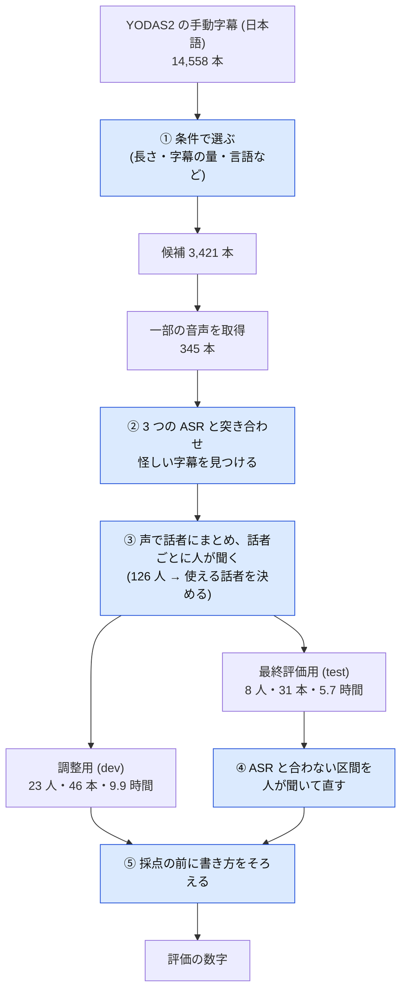
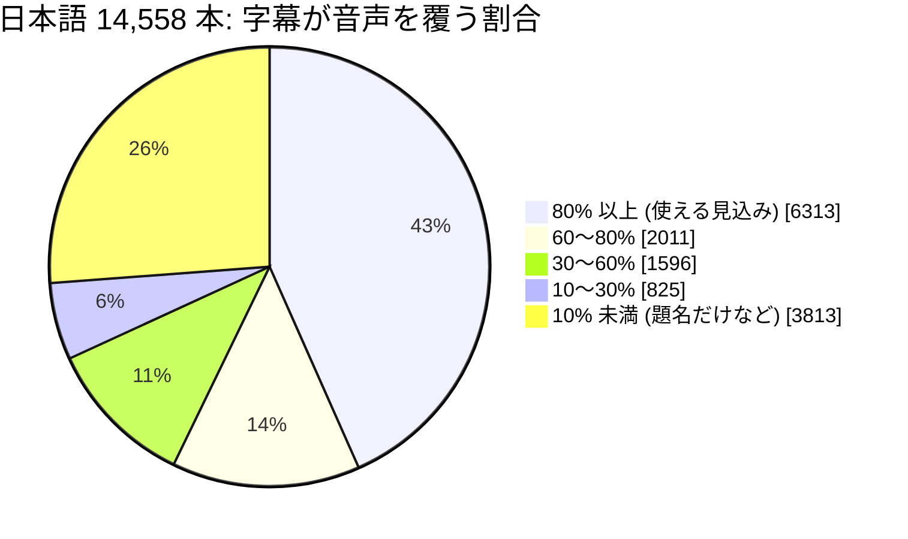
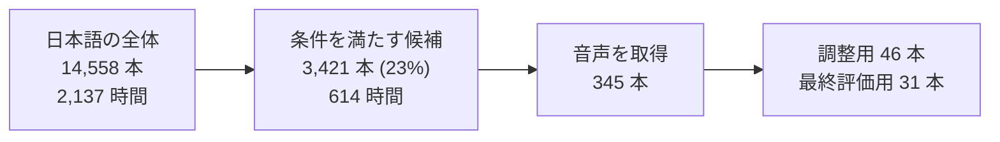
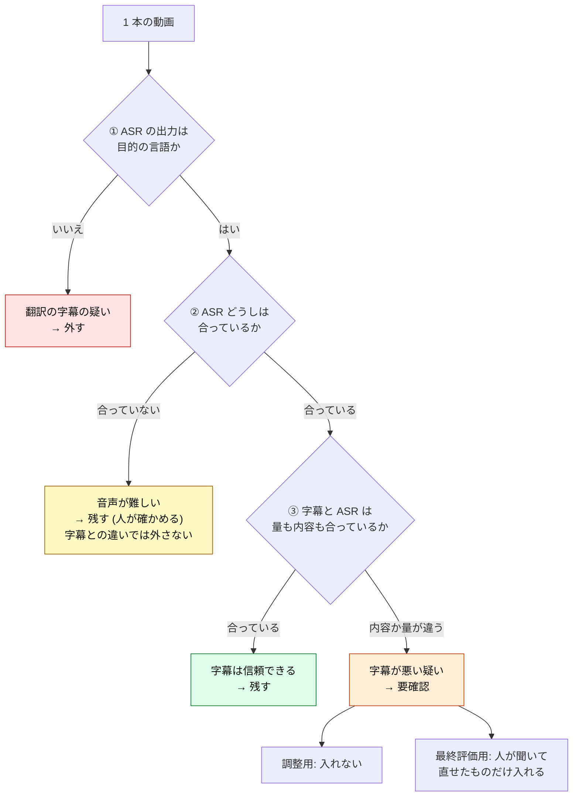
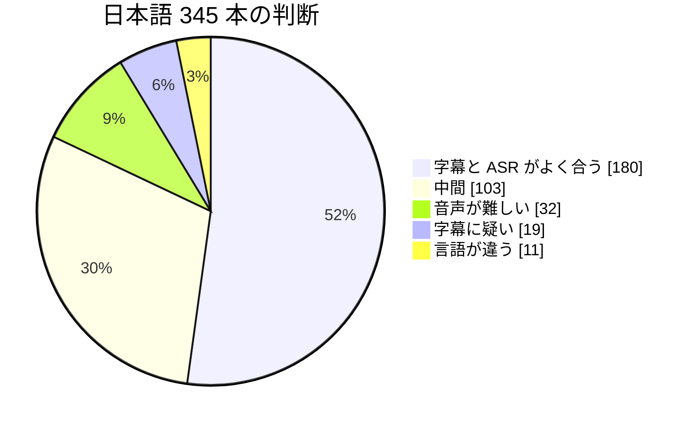
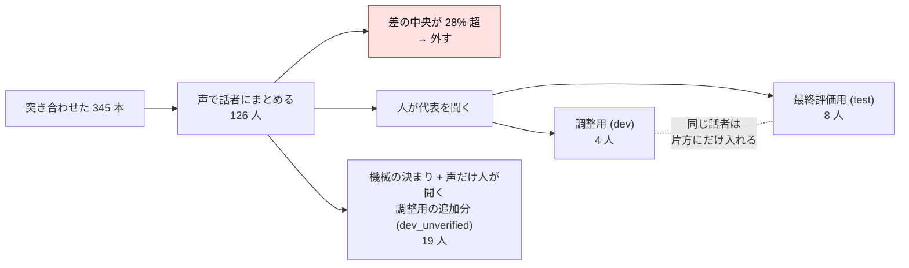

# YODAS2 長尺評価データ: 何を元に、何を変えたか

> **状態: 日本語のデータを追加済み (2026-11-18)。** 最終評価用 31 本 (5.7 時間)、調整用 46 本 (9.9 時間)。
> 英語には YODAS2 を使わないことにしました (3 章)。経緯と議論は [#488](https://github.com/Mega-Gorilla/livecap-cli/issues/488) にあります。
> データは [`benchmarks/data/yodas2/`](../../../benchmarks/data/yodas2/) にあります。使い方は [8 章](#8-データの場所と使い方)です。

## 1. まとめ

- LiveCap の字幕の精度を、**配信に近い長い音声**で測るための評価データを作っています。
- 元にするのは **YODAS2** という公開データです。YouTube で CC ライセンスが付いた動画の音声と、その字幕が入っています。
- 元のデータは**そのままでは正解として使えません**。字幕が人の書き起こしとは限らず、話した内容と違う字幕も混じっているためです。
- そこで、(1) 使える動画を条件で選び、(2) 複数の音声認識 (ASR) と突き合わせて怪しい字幕を見つけ、(3) 話者ごとに人が聞いて、使える話者を決め、(4) 最終評価に使う分は、ASR と合わない区間を人が聞いて直しました。
- **人が全部を聞いたわけではありません。** 最終評価用で人が聞いたのは 4,146 区間のうち 154 区間です。確かめ方と、残っている誤りの見積もりは 5.4 にあります。
- 使うのは日本語だけです。ゲーム実況はほとんど入っていません (全体で 1 本)。中身は解説・講義・雑談です。
- **この文書は、元のデータに何をしたかを残すためのものです。** 評価の数字を読むときは、[6 章の限界](#6-手を加えていないことと残る限界)を先に見てください。

全体の流れは次のとおりです。色の付いた箱が、元のデータに手を加える作業です。



## 2. なぜ作るのか

いまの評価データは次の 2 つで、どちらも**1 本 4 秒前後の短い読み上げ**です。

| 言語 | データ | 中身 |
|---|---|---|
| 日本語 | JSUT basic5000 から 99 本 | 女性 1 名が、静かな部屋で文を読み上げたもの |
| 英語 | LibriSpeech test-clean から 100 本 | 朗読。先頭の 100 本は同じ 1 名 |

LiveCap は配信で使われることが多く、配信の音声は次の点で読み上げと違います。

- 何十分も続く。話の間 (ま) や言い直しがある
- BGM、ゲームの音、笑い声が入る。複数の人が同時に話す
- 合成音声 (読み上げソフト) が話すことがある

短い読み上げで良い数字が出ても、配信でうまく動くとは限りません。そこで、長くて雑音のある音声の評価データを別に用意します。短い読み上げのデータは残し、設定の探索や素早い確認に使い続けます。

## 3. 元のデータ (YODAS2)

| 項目 | 内容 |
|---|---|
| 名前 | YODAS2 (`espnet/yodas2`、Hugging Face で公開) |
| 中身 | YouTube で CC ライセンスが付いた動画の音声 (24 kHz) と字幕。YODAS を、動画を切らない長いままの形にしたもの |
| ライセンス | CC BY 3.0 |
| 字幕の種類 | **手動字幕** (投稿者が自分で付けた字幕) と**自動字幕** (YouTube が機械で付けた字幕) に分かれている |
| 使う部分 | 手動字幕の日本語 (`ja000`) だけ。自動字幕は使わない |

**英語には YODAS2 を使いません。** 当初は英語 (`en000`) も使う予定で、下の調査は英語も対象にしています。しかし、英語は人が書き起こした長尺の評価データがほかにあり、字幕の質にばらつきの大きい YODAS2 をあえて使う理由がありませんでした。英語の長尺の評価データは、別に決めます。以下に残っている英語の数字は、元のデータの性質を示す参考です。

手動字幕の 2 つの部分の大きさは次のとおりです。

| | 日本語 (`ja000`) | 英語 (`en000`) |
|---|---|---|
| 動画の数 | 14,558 本 | 32,517 本 |
| 合計の長さ | 2,137 時間 | 5,143 時間 |
| 1 本の長さの中央値 | 5.1 分 | 4.0 分 |
| 字幕が音声を覆う割合の中央値 | 72% | 88% |

「字幕が音声を覆う割合」は、動画の長さのうち、字幕が付いている時間の割合です。計算は次のとおりです。

```
覆う割合 = 字幕の区間を重ね合わせた合計の時間 ÷ 動画の長さ
```

- 区間が重なっている部分は、1 回だけ数えます (区間の長さの単純な合計ではありません)。
- 動画の長さは、YODAS2 に付いている長さの情報を使います。字幕の時刻が動画の長さを超えていると、100% を超えます (このため、選ぶ条件の上限を 105% にしています)。
- **これは「字幕が表示されている時間」の割合で、「話した内容がどれだけ書き起こされているか」ではありません。** 字幕が長く表示されていても、中身が要約なら、話した内容の一部しか書かれていません。

字幕は、動画ごとに「何秒から何秒まで、この文」という区間の並びで入っています。1 つの区間の長さは 4〜5 秒が中心です。

## 4. 元のデータの問題点

調べて分かった問題を、影響の大きい順に並べます。割合のうち「途中経過」とあるものは、調査の途中 (日本語 51 本を突き合わせた時点) の数字です。問題の規模の目安として残しています。確定した結果は 5 章にあります。

### 4.1 字幕が「正解」とは限らない

「手動字幕」は、**投稿者が上げた字幕**という意味です。人が音声を聞いて書き起こしたとは限りません。実際に次のものが混じっていました。

| 問題 | 例・規模 | なぜ困るか |
|---|---|---|
| **機械の書き起こしをそのまま上げたらしい字幕** | 意味の通らない文が続く字幕がある。規模は分かっていない (下の注を参照) | 機械の出力を正解にすると、似た間違いをする ASR が有利になり、評価が成り立たない |
| **要約・言い換えの字幕** | 話した内容を短くまとめた字幕 (途中経過: 日本語 51 本中 3 本) | 正しく書き起こした ASR が「間違い」と数えられる |
| **翻訳の字幕** | 外国語の音声に、訳した字幕が付いている (途中経過: 日本語 51 本中 1 本) | 音声と字幕の言語が違うので、比べられない |
| **字幕の付け漏れ** | 話しているのに字幕が無い区間 (途中経過: 日本語 51 本で合計 16 分) | ASR が正しく書き起こした部分が「余計な出力」と数えられる |
| **題名や説明だけの字幕** | 動画の冒頭に題名を 1 つ出すだけ。日本語の 26% (字幕が音声の 10% 未満) | 話した内容が書かれていない |
| **歌詞・画面の文字** | 話した量より字幕がずっと多い | 同上 |
| **言語の表示の誤り** | 日本語の部分の 6% (880 本) は日本語でない字幕 | 同上 |

日本語の動画を、字幕が音声を覆う割合で分けると次のようになります。4 本に 1 本は、字幕がほとんど付いていません (題名だけの字幕など)。



> **注: 書式だけでは、機械の書き起こしかどうかは分かりません。** 英語では、ほかの条件を満たす動画の 16.8% (8,079 本のうち 1,358 本) が、字幕の半分以上で「全部小文字・句読点なし」でした。機械の書き起こしに多い書き方ですが、人がくだけた会話を書き起こすときにも使う書き方です (ESB の論文も、会話の書き起こしでは大文字や句読点を省く流儀があると述べています)。逆に、機械の字幕にも大文字や句読点が付くものがあります。この 16.8% は「疑わしい書式の割合」で、**由来を確かめた数字ではありません**。

さらに、人が書いた字幕でも、**発話どおりとは限りません**。「えー」「あの」のような言葉 (フィラー) や言い直しは、読みやすさのために省かれるのが普通です。発話どおりに書き起こす ASR は、その分だけ「余計な出力」として数えられます。

### 4.2 書き方が動画ごとに違う

字幕には、話した言葉以外のものが書かれていて、書き方も動画ごとに違います。

| 書き方 | 例 | 含む動画の割合 (日本語 / 英語) |
|---|---|---|
| 音の説明 | `[音楽]`、`[Music]`、`♪`、`(笑)` | 5% / 12% |
| 話者の名前 | `名前：こんにちは`、`(male)` | 4% / 8% |
| 話者が替わる印 | `>>`、行頭の `-` | 0% / 3% |
| Web の記号がそのまま残ったもの | `&amp;` (本来は `&`) | 9% / 9% |
| 句読点がほとんど無い | | 64% / 25% |
| 全部大文字の単語 | `A FIRST LOOK` | 8% / 28% |

このまま比べると、書き方の違いが「間違い」として数えられます。

### 4.3 時刻の問題

- 字幕の時刻が、音声の長さを超えている動画があります。
- **元の字幕の時刻は、正解の時刻としては使えません。** 全体をつないだ文で比べる採点 (CER / WER) は時刻を使わないので影響を受けませんが、時刻を使う評価 (発話の取りこぼし、字幕の無い区間での誤った出力、発話が終わってから結果が出るまでの遅れ) は、**人が時刻を確かめた区間だけ**で行います。**このデータでは、時刻を確かめた区間はありません** (字幕から評価データを作った TEDxJP-10K は、文だけでなく時刻も直しています)。時刻を使う評価には、まだ使えません。
- 台本を YouTube の「自動同期」にかけた字幕があります。文は正確ですが、時刻は機械が付けたもので、単語の途中で区切られています。合成音声のニュース動画に多く見られます。
- 区間が重なっている動画が、日本語 307 本、英語 527 本あります。

### 4.4 動画についての情報が無い

- **誰が投稿したか (チャンネル) が分かりません。** 評価では、設定の調整に使う動画と、最終評価に使う動画に、同じ投稿者が入らないようにしたいのですが、直接は確かめられません。
- **内容の種類 (実況、雑談、講義など) が分かりません。**
- 動画の番号は YODAS2 独自のもので、YouTube の動画の番号ではありません。作者の名前もありません。
- 元のデータに、評価用の公式の分け方はありません。このため、ほかの研究と数字を直接は比べられません。

### 4.5 中身の偏り

- **配信らしい動画は少数です。** 字幕の言葉からゲーム実況と見分けられたのは、日本語の候補 3,421 本のうち 63 本 (2%)、英語は 6,721 本のうち 104 本 (2%) でした (英語は、書式で絞っていた時点の候補での集計です)。多いのは講義、解説、ニュースのまとめです。
- **同じ投稿者の動画が大量に入っています。** 冒頭や末尾の決まり文句が同じ動画が、数百本ある例がありました。

## 5. 私たちが手を加えること

元のデータに対して行う作業を、順に説明します。**音声そのものは変えません** (ASR にかけるときに 16 kHz に変換するだけです)。変えるのは、どの動画を使うかと、字幕の文です。

### 5.1 使う動画を条件で選ぶ

字幕と長さの情報だけで、次の条件を満たす動画を残します。

| 条件 | 理由 |
|---|---|
| 長さが 5〜30 分 | 短すぎると、間 (ま) や音の切り替わりを含まない。長すぎると、1 本が結果に与える影響が大きくなりすぎる。ほかの長尺の評価データ (TED-LIUM3 は 1 本平均 16.7 分、CSJ は 30 分を超える講演を除外) にならった |
| 字幕が音声の 60〜105% を覆う | 題名だけの字幕や、付け漏れの多い字幕を除く |
| 字幕のある時間あたりの文字数が自然 (日本語 3〜12 字/秒、英語 8〜25 字/秒) | 要約や、文字を詰め込んだ字幕を除く |
| 言語が合っている (日本語はかな・漢字が 80% 以上、英語はかな・漢字を含まない) | 言語の表示の誤りを除く |
| `♪` が字幕の 5% 未満 | 歌が中心の動画を除く |
| 区間の重なりと、長さ 0 の区間が無い | 時刻が壊れた字幕を除く |

**書式だけでは外しません。** 当初は、英語で字幕の半分以上が「全部小文字・句読点なし」の動画を、機械の書き起こしとみなして外していました。しかし、この書式は由来の証明にならず、くだけた会話ほどこの書式で書かれやすいので、測りたい自然な発話を減らしてしまいます。そこで、この書式の動画も外さずに、ほかの動画と同じく 5.2 の突き合わせにかけることにしました (その後、英語には YODAS2 を使わないことにしたので、この決まりは英語の調査の記録として残しています)。

この条件で残ったのは、**日本語 3,421 本 (614 時間)、英語 8,079 本 (1,549 時間)** です。元の動画の 2 割強にあたります。



このうち実際に音声を取得したのは、一部です。YODAS2 の音声は、数十本ずつまとめた束 (shard) の単位でしか取得できません。

- **無作為に 20 束** (固定の乱数、seed 488)。動画がどの束に入るかは投稿者と関係が無いことを確かめたうえで選びました。この中の候補は 320 本 (60 時間) です。
- **狙って 6 束。** ゲーム実況が少なかったので、字幕の言葉から実況らしい候補の多い束を追加で取りました (無作為ではありません)。この中の候補は 25 本です。

合わせて **345 本**が、次の突き合わせの対象です。

### 5.2 複数の ASR と突き合わせて、怪しい字幕を見つける

条件だけでは、要約や翻訳の字幕は除けません。そこで、性質の違う 3 つの ASR に同じ音声をかけ、字幕と比べます。

| 言語 | 使う ASR |
|---|---|
| 日本語 | Whisper large-v3、Qwen3-ASR 1.7B、ReazonSpeech |

見るのは、次の 3 つです。上から順に判断します。

| 順 | 見ること | 結果 | 判断 |
|---|---|---|---|
| 1 | ASR の出力の言語 | 目的の言語でない | 翻訳の字幕の疑い → 外す (最終評価用は人が確かめてから) |
| 2 | ASR どうしが合っているか | **合っていない** | **音声が難しい → 残す。** ASR の出力をあてにできないので、字幕の良し悪しはここでは判断しない。字幕と量や内容が違っていても外さない |
| 3 | (ASR どうしが合っているとき) 字幕と ASR | 量も内容も合っている | 字幕は信頼できる → 残す |
| 3 | 同上 | 内容が違う、または量が大きく違う | 字幕が悪い疑い (要約、言い換え、歌詞など) → 「要確認」 |

これとは別に、字幕の無い区間で複数の ASR が言葉を出していれば、字幕の付け漏れの疑いとして記録します。

**順序が大事です。** 字幕と ASR の量を比べるのは、**ASR どうしが合っていると確かめたあと**です。雑音で ASR が少ししか書き起こせない動画では、正しい字幕が「ASR より多すぎる」ように見えます。先に量で外すと、いちばん測りたい難しい音声を落としてしまいます。

この判定は、動画を外す決め手ではなく、**人がどこを聞くかを決める手がかり**として使いました (5.3)。



大事な点が 2 つあります。

- **ASR の出力で字幕を書き換えるのは、決まった 2 つの型だけです。** 書き換えるほど、その ASR に有利な正解になるためです。ASR は主に「怪しい箇所を見つける」ために使います。例外の 2 つ (字幕と読みが違う語、括弧の中の発話) は 5.4 にあり、どの区間がそれにあたるかは変更の記録に残しています。
- **「字幕と合わない」だけでは外しません。** 音声が難しくて合わない動画こそ、測りたいものだからです。字幕を疑うのは、ASR どうしは合っているのに字幕とだけ違う場合です。

345 本の結果は次のとおりです。

| 判断 | 本数 |
|---|---:|
| 字幕と ASR がよく合う | 180 |
| 中間 | 103 |
| 音声が難しい (ASR どうしが合わない) | 32 |
| 字幕に疑い (内容・要約・多すぎ) | 19 |
| 言語が違う | 11 |



この判定だけでは決められないことが、人が聞いて分かりました。

- **「中間」は安全ではありません。** 字幕と ASR の差が 25〜34% の動画を聞くと、字幕の誤りが全体にあるものがありました。
- **「字幕に疑い」には、時刻のずれが混ざります。** 内容は正確なのに、途中から時刻が大きくずれている動画がありました (区間ごとに比べると差は 72%、動画全体をつなげて比べると 26%)。区間ごとの差と全体の差を両方見て、時刻のずれを内容の誤りと分けました。
- **字幕の質は、動画ではなく話者 (投稿者) で決まっていました。** 字幕と ASR の差のばらつきの約 7 割が、話者の違いで説明できました。そこで、動画ごとではなく話者ごとに判断することにしました (5.3)。

### 5.3 話者にまとめ、話者ごとに人が聞いて、2 つに分ける

評価データを 2 つに分けます。分けるのは、調整に使ったデータで評価すると、数字が実力より良く出るためです。

| 名前 | 用途 | 規模 | 字幕の確かめ方 |
|---|---|---|---|
| **最終評価用 (test)** | 最後の評価にだけ使う。調整の途中では一度も見ない | 8 人・31 本・5.7 時間 | 話者ごとに人が聞いて採否を決め、ASR と合わない区間を人が聞いて直した (5.4) |
| **調整用 (dev)** | 音声を区切る設定などを調整するのに使う | 4 人・25 本・5.9 時間 | 話者ごとに人が代表の動画を聞いて「使える」とした |
| **調整用の追加分 (dev_unverified)** | 同上。話者を増やすための追加 | 19 人・21 本・4.0 時間 | **字幕は人が見ていない。** 機械の決まりで選び、声だけ人が聞いた |

#### 話者にまとめる

投稿者の情報が無いので、**声の特徴**で動画をまとめました。話者の声を数値にするモデル (TitaNet) で動画ごとの特徴を出し、近いもの (cos 類似度 0.65 以上、平均連結) を同じ話者としました。345 本が 126 人になりました。

当初は、冒頭・末尾の決まり文句も手がかりにしていました。しかし、決まり文句で結ぶと別の人が同じまとまりに入ることが分かり、声だけにしました。

#### 話者ごとに決める

| 順 | 決まり | 理由 |
|---|---|---|
| 1 | 字幕と ASR (`qwen3asr_large`) の差の中央が 28% を超える話者は、機械的に外す | 聞いた範囲で、差の大きい話者の字幕はすべて使えなかった |
| 2 | 残った話者は、人が代表の動画を聞いて「使える / 使えない」を決める | 差が小さくても、自動字幕をそのまま上げた話者や、合成音声の話者がいた |
| 3 | 合成音声の話者は外す | 人の発話の評価にならない。数値でも声の特徴でも見分けられなかったので、人が聞いた |

人が「使える」とした話者を、最終評価用と調整用に割り当てました。決まりは次のとおりです。

- 最終評価用は 5 人以上、調整用は 3 人以上。**同じ話者を両方に入れない**
- 1 人の時間は、各組の目標 (最終評価用 5.5 時間、調整用 6 時間) の 3 割まで
- この決まりの中で、時間が目標に近くなる割り当てを総当たりで選ぶ

#### 調整用の追加分

人が聞けた話者は限られるので、調整用には、人が字幕を見ていない動画を足しています。

- 字幕は機械の決まりで選ぶ: 3 つの ASR のうち最も近いものとの差が 16% 以下なら採用。16〜35% でも、句読点が 100 字あたり 1 つ以上あれば採用。この決まりは、人の判断 162 本に合わせて作り、その 162 本では 157 本 (97%) が判断と合った。別に抜き取った 15 本では 11 本が合い、外れた 4 本のうち 2 本は合成音声だった
- 声は人が聞く: 動画ごとに 10 秒聞いて、人の声か合成音声かを決めた。35 本のうち、人の声 28 本、合成音声 5 本、そのほか不適 2 本
- 字幕が発話の要約らしい動画は外す: 字幕より ASR の出力が 1.5 倍以上長い区間が 5% 以上ある動画 (6 本)。最終評価用で「字幕が要約」と分かった話者 (5.4) の値が 7〜9%、人が「使える」とした話者は 3.5% 未満だったことから決めた

**追加分は、一覧で `dev_unverified` として区別しています。** 調整の結果を見るときは、`dev` だけの値と分けて見られます。



### 5.4 字幕を直す

#### 話していない文字を消す (すべての動画)

字幕から、話した言葉でないものを機械的に消しました。句読点やかぎかっこは触りません (採点のときにそろえます)。

| 消すもの | 例 |
|---|---|
| 話者の印 | `Y:だってね！` → `だってね！` (同じ印が 3 回以上出る動画だけ) |
| 括弧の注記 | 読み、訳、`（笑）`、`（咳払い）` |
| `[ ]` の印、`【 】` の説明 | `[音楽]`、`[拍手]`、画面の説明 |
| ふりがな | `憐憫《あわれみ》` → `憐憫` |
| 伏せ字、`♪`、`BGM` だけの字幕 | |

**括弧の中を読み上げる話者がいました。** 「括弧の中はすべて消す」とした当初の処理は、発話を消していました (`山頂(ピーク)まで` の「ピーク」)。そこで、消した括弧の中身を 2 つ以上の ASR が書き起こしている箇所は、括弧の記号だけを消して中身を残しています (14 か所: 最終評価用 9、調整用の追加分 5)。**この 14 か所は、ASR の一致で決めたもので、1 か所ずつ人が聞いてはいません。**

#### 最終評価用: ASR と合わない区間を人が聞く

最終評価用の 5.7 時間を、人が通しで聞いてはいません。次の形で確かめました。

1. **印を付ける。** 字幕の区間のうち、`qwen3asr_large` との差が 30% 以上で、**かつ** `whispers2t`・`reazonspeech` のどちらとも合わない (差 20% 超) 区間に印を付ける。4,146 区間のうち 201 区間
2. **話者ごとに聞く。** 印の付いた区間を話者ごとに 10 件以上、印の無い区間から無作為の抜き取りを聞き、1 区間ずつ「合っている / 言葉が違う / 表記だけ違う / 聞き取れない」を決める
3. **直す。** 「言葉が違う」区間に、3 つの ASR の出力を見比べて直す案を作り、人が音声と聞き比べて採否を決める

直した字幕は、決め方で 2 つに分かれます。

| 決め方 | 区間 | 中身 |
|---|---:|---|
| **人が聞いて認めた** | 13 | 3 で作った案のうち、人が音声と聞き比べて採用したもの |
| **ASR の一致で決めた (人は 1 区間ずつは聞いていない)** | 22 | 字幕「米国」・発話「アメリカ」の置き換え (下の表) |

ASR の一致で決めた 22 区間は、人が「この話者は米国をアメリカと読んでいる」と聞いて判断したうえで、2 つ以上の ASR が「アメリカ」と書き起こした区間に当てたものです。区間ごとの決め方は、[`caption_changes.tsv`](../../../benchmarks/data/yodas2/ja/caption_changes.tsv) の `method` 列にあります (`listened` が人が聞いたもの、`asr_agreement` が ASR の一致で決めたもの、`text_rule` が書式の除去)。区間の印 (`segments.tsv`) の `edited` は「言葉を直した」という変更の種類で、人が聞いたかどうかは表しません。

聞いたのは 154 区間で、結果は次のとおりです。

| 判断 | 区間 | 扱い |
|---|---:|---|
| 合っている | 108 | そのまま |
| 表記だけ違う | 19 | 字幕は直さない。`notation` の印を付ける。プログラムのコードや URL の読み上げ (`SELECT` と「セレクト」)、英語とカタカナ |
| 口ぐせ・言い直しを字幕が省いている | 7 | 字幕は直さない。`disfluency` の印を付ける。採点でフィラーを除く (5.6) |
| 言葉を直した | 17 | 下の表 |
| 聞き取れない | 3 | `excluded` の印を付け、採点から外す |

直した内容は次のとおりです。

| 型 | 例 |
|---|---|
| 字幕と読みが違う語 | 字幕「米国」、発話「アメリカ」。1 人の話者に 27 区間あり、2 つ以上の ASR が「アメリカ」と一致した 22 区間は ASR の一致で置き換え、ASR が割れた 5 区間は人が聞いて直した |
| 字幕の言葉が発話と違う | `経験によると` → `経験ですが` |
| 繰り返しの略記 | `来てる×3` → `来てる来てる来てる` |
| 括弧の中の発話 | 上の「括弧の中を読み上げる話者」 |

**話者 1 人は、字幕が発話の要約でした** (聞いた 25 区間のうち 15 が「言葉が違う」)。この話者は最終評価用から外しました。

#### 残っている誤りの見積もり

| 区間 | 数 | 字幕の言葉の誤り |
|---|---:|---|
| 印あり・聞いていない | 約 140 | 10 区間前後の見込み (聞いた範囲では、印ありの 7% が字幕の誤り) |
| 印なし | 約 3,900 | 抜き取り 50 件で 0 件。**この結果から言えるのは「多くても 6% 未満」まで** |

- 印を ASR との差で付けているので、**字幕と 3 つの ASR が同じ間違いをしている区間は見つかりません。**
- 字幕が口ぐせや言い直しを省いている区間は、ASR も同じように省くことがあり、印が付きにくくなります。採点でフィラーを除くことで、影響を小さくしています。
- どの区間をどう直したか、人が聞いたか ASR の一致で決めたかは、[`caption_changes.tsv`](../../../benchmarks/data/yodas2/ja/caption_changes.tsv) にあります。

### 5.5 採点の前に書き方をそろえる

採点 (字幕と ASR の出力を比べること) の直前に、**字幕と ASR の出力の両方**に同じ処理をかけ、書き方の違いが「間違い」と数えられないようにします。字幕のファイルそのものは書き換えません。

| 処理 | 例 |
|---|---|
| Web の記号を元に戻す | `&amp;` → `&` |
| 全角と半角をそろえる | `１２３` → `123` |
| 音の説明を消す | `[音楽]`、`♪`、`(笑)`、`(laughs)` |
| 話者が替わる印を消す | `>>`、行頭の `-` |
| フィラーの印を消す | `(F えー)` (このデータの字幕には付けていないが、正規化は対応している) |
| 句読点・記号・空白を消す (日本語)、大文字と小文字をそろえる | |
| (英語) 数字や短縮形の書き方をそろえる | `twenty` と `20`、`can't` と `can not` |

**推測では消さない**ことにしています。例えば、話者の名前 (`名前：`) は、名前が分かっているときだけ消します。「`語：`の形なら名前だろう」と推測して消すと、`午前10:30` や `注意：足元に…` のような、実際に話した言葉まで消えてしまうためです。括弧も、中身が音の説明と分かっている言葉 (`笑`、`laughs` など) のときだけ消します。

ただし、**英語は例外で、括弧の中身がすべて消えます** (`He studies (music theory)` の `(music theory)` も消える)。英語の採点には、広く使われている Whisper 標準の処理をそのまま使っていて、その処理が括弧の中身をすべて消すためです。日本語と扱いが違う点として、知っておいてください。

この処理の詳しい規則は [ASR ベンチマークガイドの「採点の前の正規化」](./asr-benchmark.md) にあります (実装は [#493](https://github.com/Mega-Gorilla/livecap-cli/pull/493) で、取り込み済みです)。

### 5.6 数字の出し方

主に見る数字は、日本語は文字単位の誤りの割合 (CER)、英語は単語単位の誤りの割合 (WER) です。動画ごとの平均ではなく、**全体を合わせた値** (誤りの総数 ÷ 正解の総文字数・総単語数) で出します。

これだけでは見えないものがあるので、次の数字を並べて出します。

| 並べて出す数字 | 何が分かるか |
|---|---|
| 誤りの内訳 (置き換え・抜け・余計な出力) | **正解の字幕**がフィラーを省いたり要約したりしていると、ASR が正しく書き起こした言葉が「余計な出力」に数えられる。**ASR** が言葉を落としたり要約したりすると「抜け」に数えられる。内訳を見れば、どちらが起きているかの見当が付く |
| フィラーを両方から除いた値 | フィラーを書くか省くかという流儀の違いを除いた精度 |
| 数字の書き方をそろえた値 | `三つ` と `3つ` のような違いを除いた精度 |
| 読み (かな) に直して比べた値 | `出来る` と `できる` のような、漢字とかなの違いを除いた精度 |

これらは [#488](https://github.com/Mega-Gorilla/livecap-cli/issues/488) で決めた方針で、数える処理は実装済みです ([ASR ベンチマークガイドの「誤りの内訳と、並べて出す値」](./asr-benchmark.md))。このデータを採点する手順は、データを追加するときに書き足します。

**このデータでは、「フィラーを両方から除いた値」を主の数字にします。** 字幕を聞いて確かめた結果、人が付けた字幕は「えっと」「あのー」を省くのが普通でした。一方、ASR はフィラーを書くものと落とすものがあります。そのまま比べると、フィラーを落とす ASR が有利になります。そのままの値も、並べて出します。

## 6. 手を加えていないことと、残る限界

評価の数字を読むときに、知っておいてほしい点です。

| 限界 | 内容 |
|---|---|
| **人が聞いたのは一部だけ** | 最終評価用で聞いたのは 4,146 区間のうち 154 区間。調整用は、話者ごとに代表を聞いただけ。調整用の追加分 (`dev_unverified`) は、字幕を人が見ていない。要約や付け漏れが残りうる |
| **ゲーム実況がほとんど無い** | 全体で 1 本。中身は解説・講義・雑談。配信の実況に近い音声の評価には、別のデータが要る |
| **日本語だけ** | 英語には使っていない |
| **3 つの ASR が同じ間違いをすると見抜けない** | 突き合わせは「ASR どうしが合っているのに字幕だけ違う」を手がかりにする。ASR がそろって間違える箇所では、正しい字幕を「悪い」と判断するおそれがある。逆もある |
| **ASR との一致で選ぶと、易しい音声に偏る** | 判定で残りやすいのは、ASR がうまく書き起こせる動画。難しい音声が減る方向の偏りがありうる。「音声が難しい」動画を外さないことで和らげているが、無くせてはいない |
| **漢字とかな、数字の書き方の違いは、主の数字では「間違い」に数える** | `出来る` と `できる`、`三つ` と `3つ`。並べて出す数字で影響を見られるようにする |
| **投稿者を完全には分けられない** | 声の特徴での代用。同じ投稿者が両方に入る可能性は残る。1 人の投稿者の動画に複数の人が出ていれば、別の話者として扱われる |
| **機械の書き起こしの字幕が残りうる** | 書式では見分けられない。機械の字幕が ASR とよく合えば「信頼できる」と判断される。最終評価用と調整用は、話者ごとに人が聞いて自動字幕らしい話者を外したが、調整用の追加分には残りうる。`[音楽]` の印が付く動画 (自動字幕に多い) が 12 本あり、人が聞いて「手で直した字幕」と判断して残している |
| **時刻を使う評価には使えない** | 元の字幕の時刻は機械が付けたものや粗いものがある。人が時刻を確かめた区間は無い。取りこぼしや遅れは、このデータでは測れない |
| **配信そのものではない** | 元は投稿された動画で、生配信の録画とは限らない。ゲーム実況は少数 |
| **ほかの研究と数字を比べられない** | 動画の選び方も字幕の直し方も、このプロジェクト独自 |
| **日本語の 3 つ目の ASR は弱い** | ReazonSpeech は長い入力で言葉を落とすので、短く分けてかけている。それでも字幕との差がほかの 2 つより大きい (最終評価用で、ほかの 2 つが 10〜13% のところ 27%)。3 つの一致で決める箇所は、実質 2 つの一致に近い |
| **選ぶのに使った ASR が、評価される側でもある** | 動画の選び方も、聞く区間の印も、Whisper・Qwen3-ASR・ReazonSpeech の出力に頼っている。字幕の一部 (最終評価用の 31 区間、調整用の追加分の 5 か所) は、これらの ASR の一致で書き換えている。これらの ASR が得意な音声に偏り、これらの ASR に有利な数字になりうる |

## 7. 出典とライセンス

- 元のデータ: YODAS2 (`espnet/yodas2`)。Li ほか「YODAS: Youtube-Oriented Dataset for Audio and Speech」(ASRU 2023)。
- ライセンス: [CC BY 3.0](https://creativecommons.org/licenses/by/3.0/)。元は、YouTube で CC ライセンスが付いた動画です。
- **このリポジトリに置くのは、字幕の文と、動画の一覧 (どの動画をどちらに入れたか) だけです。音声は置きません。** 音声は、一覧を元に YODAS2 から各自で取得します。
- 動画は、YODAS2 が付けた**仮の ID** で示します。YODAS2 の配布元は ID を書き換えて配っており、元の YouTube の ID を公開していません。このため、元の動画の URL・題名・投稿者の名前は書けません。このプロジェクトは、仮の ID を元に戻すことも、投稿者を特定することもしません。
- 字幕の文には、5 章のとおり手を加えています。これは CC BY 3.0 が求める「変更した旨の表示」にあたります。
- 元のデータの作者や動画の投稿者が、このプロジェクトを推奨・支持しているわけではありません。
- 動画の投稿者から削除の依頼があれば、その動画の字幕と一覧の行を消します。
- 分かっていない点: 手動字幕を書いた人が投稿者本人とは限りません。また、YODAS の収集は「ほぼ CC ライセンス」とされています。字幕の文だけを少数置くこと、削除の依頼に応じることで、影響を小さくします。

出典の表示の全文は [`benchmarks/data/yodas2/ATTRIBUTION.md`](../../../benchmarks/data/yodas2/ATTRIBUTION.md) にあります。

## 8. データの場所と使い方

| 場所 | 中身 |
|---|---|
| [`benchmarks/data/yodas2/ja/manifest.tsv`](../../../benchmarks/data/yodas2/ja/manifest.tsv) | 動画の一覧。仮の ID、YODAS2 の中の場所 (`yodas2_subset`、`yodas2_shard`)、`split`、話者の番号、長さ、内容の種類、印 (`tags`)、話している部分の音量、区間の数 |
| `benchmarks/data/yodas2/ja/captions/<audio_id>.srt` | 手を加えたあとの字幕 |
| [`benchmarks/data/yodas2/ja/segments.tsv`](../../../benchmarks/data/yodas2/ja/segments.tsv) | 最終評価用の区間の印 (`edited`、`notation`、`disfluency`、`excluded`) |
| [`benchmarks/data/yodas2/ja/caption_changes.tsv`](../../../benchmarks/data/yodas2/ja/caption_changes.tsv) | 字幕の変更の前後 (区間ごと)。`method` 列が決め方 (`listened` 人が聞いた / `asr_agreement` ASR の一致 / `text_rule` 書式の除去)。字幕から消した話者の印は話した言葉ではないので、「直す前」の列でも `<話者>:` に伏せている |

`tags` は、`multi_speaker` (複数の人が話す)、`non_native` (日本語が母語でない話者)、`low_volume` (音量が小さい) です。印を付けて残しています。配信にも、こうした音声はあるためです。

音声は、次の script で YODAS2 から取ります。取得元は、このデータを作ったときの版 (`espnet/yodas2` の revision `631fc446cb1a41ee93a1d390a167c6e08c2597a3`) に固定しています (`--revision` で変えられます)。16 kHz・モノラルの WAV にするだけで、**音量は変えません** (元の音量の差は、話している部分で最大 20 dB あります。一覧の `speech_level_db` で、音量ごとの成績を見られます)。

```bash
python scripts/prepare_yodas2_audio.py --split test   # 最終評価用だけ (16 束を順に取る)
python scripts/prepare_yodas2_audio.py                # 全部 (22 束)
```

読み込みは [`benchmarks/common/yodas2.py`](../../../benchmarks/common/yodas2.py) の `load_videos()` です。

```python
from benchmarks.common.yodas2 import load_videos
from benchmarks.common.error_breakdown import aggregate, count_errors

videos = load_videos("test")
# hypothesis_for(v) は、その動画の音声を ASR にかけた出力 (各自で用意する)
counts = [count_errors(v.reference(), hypothesis_for(v), lang="ja", variant="fillers") for v in videos]
print(aggregate(counts).rate)
```

`reference()` は、`excluded` の区間を除いた字幕をつなげた文です。`reference(include_notation=False)` で、表記だけ違う区間も除けます。除いた区間の時刻は `unscored_spans()` で取れるので、ASR の出力のうち、その時刻に重なる部分を除いてから比べます。

全部の ASR をこのデータで測り直す手順は、測り直すときに [ASR ベンチマークガイド](./asr-benchmark.md) へ書き足します。

## 9. 参考にした資料

| 資料 | 何を参考にしたか |
|---|---|
| Whisper (Radford ほか、arXiv 2212.04356) | 長い音声の評価のしかた (動画全体をつないだ文で比べる)、英語の書き方をそろえる処理 |
| TED-LIUM 3 (arXiv 1805.04699)、Earnings-22 (arXiv 2203.15591) | 長尺の評価データの 1 本の長さと本数 |
| CSJ (日本語話し言葉コーパス) | 30 分を超える録音を除く考え方、フィラーの印 `(F …)` |
| ESB (arXiv 2210.13352) | 調整用と最終評価用の役割の分け方 |
| JTubeSpeech (arXiv 2112.09323) | YouTube の字幕から評価データを作るときの、字幕の選び方 |
| OWSM v4 (arXiv 2506.00338)、Loquacious (arXiv 2505.21578) | YODAS の字幕の質の問題と、ふるい分けの方法 |
| Nozawa ほか (arXiv 2408.08027) | 同じ `ja000` から調整用・評価用を作った例 (各 10 時間) |
| LaboroTVSpeech / TEDxJP-10K (arXiv 2103.14736) | 字幕を発話どおりに書き直して評価データにした例 |
| ReazonSpeech、Nue ASR (arXiv 2312.03668) | 日本語の採点での数字の扱い |
| Karita ほか (arXiv 2306.04530) | 漢字とかなの書き方の違いが CER に与える影響 |
