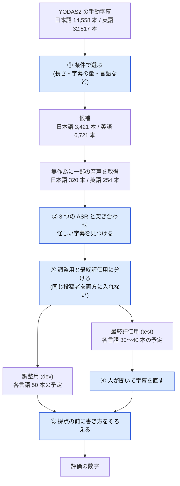
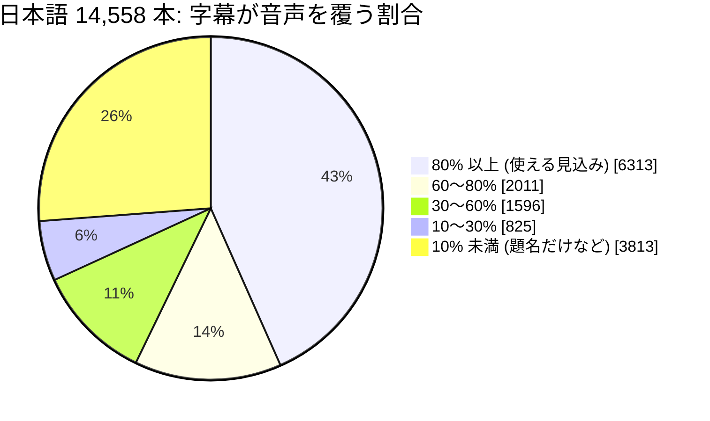
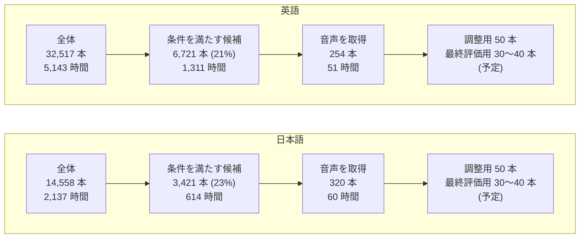
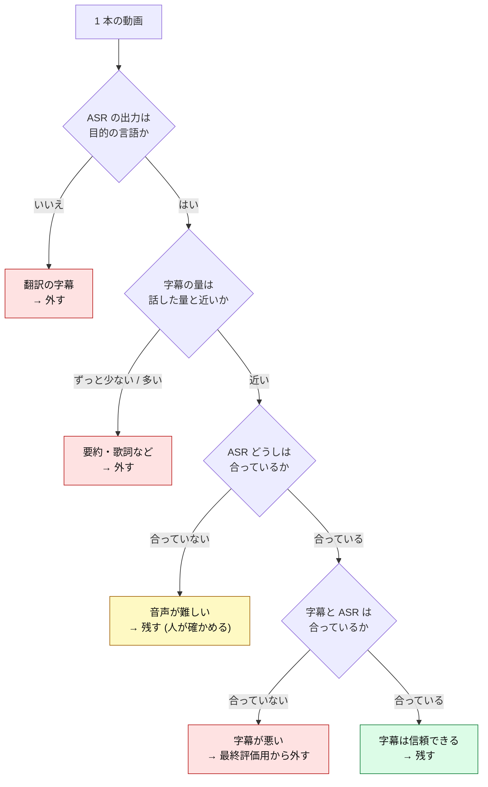
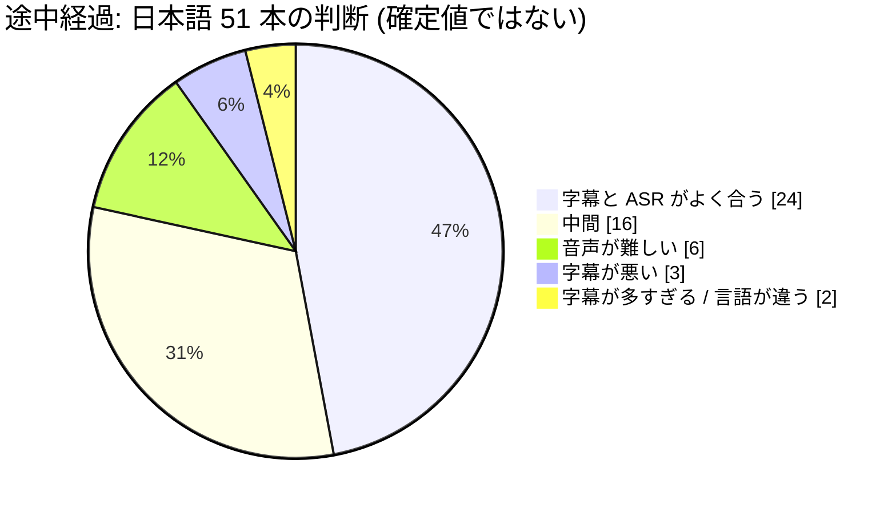
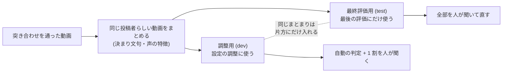

# YODAS2 長尺評価データ: 何を元に、何を変えたか

> **状態: 作成中 (2026-11-12 時点)。** 元のデータの調査と、選び方・直し方の方針までを書いています。
> 動画の最終的な本数、除外した数の確定値、字幕を直した内容は、データを追加するときに埋めます。
> 未確定の箇所には「未確定」と書いてあります。経緯と議論は [#488](https://github.com/Mega-Gorilla/livecap-cli/issues/488) にあります。

## 1. まとめ

- LiveCap の字幕の精度を、**配信に近い長い音声**で測るための評価データを作っています。
- 元にするのは **YODAS2** という公開データです。YouTube で CC ライセンスが付いた動画の音声と、その字幕が入っています。
- 元のデータは**そのままでは正解として使えません**。字幕が人の書き起こしとは限らず、話した内容と違う字幕も混じっているためです。
- そこで、(1) 使える動画を条件で選び、(2) 複数の音声認識 (ASR) と突き合わせて怪しい字幕を見つけ、(3) 最終評価に使う分は人が聞いて直します。
- **この文書は、元のデータに何をしたかを残すためのものです。** 評価の数字を読むときは、[6 章の限界](#6-手を加えていないことと残る限界)を先に見てください。

全体の流れは次のとおりです。色の付いた箱が、元のデータに手を加える作業です。

## 2. なぜ作るのか

いまの評価データは次の 2 つで、どちらも**1 本 4 秒前後の短い読み上げ**です。

| 言語 | データ | 中身 |
|---|---|---|
| 日本語 | JSUT basic5000 から 99 本 | 女性 1 名が、静かな部屋で文を読み上げたもの |
| 英語 | LibriSpeech test-clean から 100 本 | 朗読。先頭の 100 本は同じ 1 名 |

LiveCap は配信で使われることが多く、配信の音声は次の点で読み上げと違います。

- 何十分も続く。話の間 (ま) や言い直しがある
- BGM、ゲームの音、笑い声が入る。複数の人が同時に話す
- 合成音声 (読み上げソフト) が話すことがある

短い読み上げで良い数字が出ても、配信でうまく動くとは限りません。そこで、長くて雑音のある音声の評価データを別に用意します。短い読み上げのデータは残し、設定の探索や素早い確認に使い続けます。

## 3. 元のデータ (YODAS2)

| 項目 | 内容 |
|---|---|
| 名前 | YODAS2 (`espnet/yodas2`、Hugging Face で公開) |
| 中身 | YouTube で CC ライセンスが付いた動画の音声 (24 kHz) と字幕。YODAS を、動画を切らない長いままの形にしたもの |
| ライセンス | CC BY 3.0 |
| 字幕の種類 | **手動字幕** (投稿者が自分で付けた字幕) と**自動字幕** (YouTube が機械で付けた字幕) に分かれている |
| 使う部分 | 手動字幕の日本語 (`ja000`) と英語 (`en000`) だけ。自動字幕は使わない |

使う 2 つの部分の大きさは次のとおりです。

| | 日本語 (`ja000`) | 英語 (`en000`) |
|---|---|---|
| 動画の数 | 14,558 本 | 32,517 本 |
| 合計の長さ | 2,137 時間 | 5,143 時間 |
| 1 本の長さの中央値 | 5.1 分 | 4.0 分 |
| 字幕が音声を覆う割合の中央値 | 72% | 88% |

「字幕が音声を覆う割合」は、動画の長さのうち、字幕が付いている時間の割合です。話している時間のすべてに字幕が付いていれば高くなります。

字幕は、動画ごとに「何秒から何秒まで、この文」という区間の並びで入っています。1 つの区間の長さは 4〜5 秒が中心です。

## 4. 元のデータの問題点

調べて分かった問題を、影響の大きい順に並べます。割合のうち「途中経過」とあるものは、突き合わせの途中の数字で、確定していません。

### 4.1 字幕が「正解」とは限らない

「手動字幕」は、**投稿者が上げた字幕**という意味です。人が音声を聞いて書き起こしたとは限りません。実際に次のものが混じっていました。

| 問題 | 例・規模 | なぜ困るか |
|---|---|---|
| **機械の書き起こしをそのまま上げた字幕** | 英語の候補の約 16%。全部小文字で句読点が無い、意味の通らない文がある | 機械の出力を正解にすると、似た間違いをする ASR が有利になり、評価が成り立たない |
| **要約・言い換えの字幕** | 話した内容を短くまとめた字幕 (途中経過: 日本語 51 本中 3 本) | 正しく書き起こした ASR が「間違い」と数えられる |
| **翻訳の字幕** | 外国語の音声に、訳した字幕が付いている (途中経過: 日本語 51 本中 1 本) | 音声と字幕の言語が違うので、比べられない |
| **字幕の付け漏れ** | 話しているのに字幕が無い区間 (途中経過: 日本語 51 本で合計 16 分) | ASR が正しく書き起こした部分が「余計な出力」と数えられる |
| **題名や説明だけの字幕** | 動画の冒頭に題名を 1 つ出すだけ。日本語の 26% (字幕が音声の 10% 未満) | 話した内容が書かれていない |
| **歌詞・画面の文字** | 話した量より字幕がずっと多い | 同上 |
| **言語の表示の誤り** | 日本語の部分の 6% (880 本) は日本語でない字幕 | 同上 |

日本語の動画を、字幕が音声を覆う割合で分けると次のようになります。4 本に 1 本は、字幕がほとんど付いていません (題名だけの字幕など)。

さらに、人が書いた字幕でも、**発話どおりとは限りません**。「えー」「あの」のような言葉 (フィラー) や言い直しは、読みやすさのために省かれるのが普通です。発話どおりに書き起こす ASR は、その分だけ「余計な出力」として数えられます。

### 4.2 書き方が動画ごとに違う

字幕には、話した言葉以外のものが書かれていて、書き方も動画ごとに違います。

| 書き方 | 例 | 含む動画の割合 (日本語 / 英語) |
|---|---|---|
| 音の説明 | `[音楽]`、`[Music]`、`♪`、`(笑)` | 5% / 12% |
| 話者の名前 | `名前：こんにちは`、`(male)` | 4% / 8% |
| 話者が替わる印 | `>>`、行頭の `-` | 0% / 3% |
| Web の記号がそのまま残ったもの | `&amp;` (本来は `&`) | 9% / 9% |
| 句読点がほとんど無い | | 64% / 25% |
| 全部大文字の単語 | `A FIRST LOOK` | 8% / 28% |

このまま比べると、書き方の違いが「間違い」として数えられます。

### 4.3 時刻の問題

- 字幕の時刻が、音声の長さを超えている動画があります (本数は未確定)。
- 台本を YouTube の「自動同期」にかけた字幕があります。文は正確ですが、時刻は機械が付けたもので、単語の途中で区切られています。合成音声のニュース動画に多く見られます。
- 区間が重なっている動画が、日本語 307 本、英語 527 本あります。

### 4.4 動画についての情報が無い

- **誰が投稿したか (チャンネル) が分かりません。** 評価では、設定の調整に使う動画と、最終評価に使う動画に、同じ投稿者が入らないようにしたいのですが、直接は確かめられません。
- **内容の種類 (実況、雑談、講義など) が分かりません。**
- 動画の番号は YODAS2 独自のもので、YouTube の動画の番号ではありません。作者の名前もありません。
- 元のデータに、評価用の公式の分け方はありません。このため、ほかの研究と数字を直接は比べられません。

### 4.5 中身の偏り

- **配信らしい動画は少数です。** 字幕の言葉からゲーム実況と見分けられたのは、日本語の候補 3,421 本のうち 63 本 (2%)、英語は 6,721 本のうち 104 本 (2%) でした。多いのは講義、解説、ニュースのまとめです。
- **同じ投稿者の動画が大量に入っています。** 冒頭や末尾の決まり文句が同じ動画が、数百本ある例がありました。

## 5. 私たちが手を加えること

元のデータに対して行う作業を、順に説明します。**音声そのものは変えません** (ASR にかけるときに 16 kHz に変換するだけです)。変えるのは、どの動画を使うかと、字幕の文です。

### 5.1 使う動画を条件で選ぶ

字幕と長さの情報だけで、次の条件を満たす動画を残します。

| 条件 | 理由 |
|---|---|
| 長さが 5〜30 分 | 短すぎると、間 (ま) や音の切り替わりを含まない。長すぎると、1 本が結果に与える影響が大きくなりすぎる。ほかの長尺の評価データ (TED-LIUM3 は 1 本平均 16.7 分、CSJ は 30 分を超える講演を除外) にならった |
| 字幕が音声の 60〜105% を覆う | 題名だけの字幕や、付け漏れの多い字幕を除く |
| 字幕のある時間あたりの文字数が自然 (日本語 3〜12 字/秒、英語 8〜25 字/秒) | 要約や、文字を詰め込んだ字幕を除く |
| 言語が合っている (日本語はかな・漢字が 80% 以上、英語はかな・漢字を含まない) | 言語の表示の誤りを除く |
| `♪` が字幕の 5% 未満 | 歌が中心の動画を除く |
| 区間の重なりと、長さ 0 の区間が無い | 時刻が壊れた字幕を除く |
| (英語のみ) 字幕の半分以上が「全部小文字で句読点なし」ではない | 機械の書き起こしを上げた字幕を除く |

この条件で残ったのは、**日本語 3,421 本 (614 時間)、英語 6,721 本 (1,311 時間)** です。元の動画の 2 割ほどにあたります。

このうち実際に音声を取得したのは、無作為に選んだ一部です。YODAS2 の音声は、数十本ずつまとめた束 (shard) の単位でしか取得できません。動画がどの束に入るかは投稿者と関係が無いことを確かめたうえで、固定の乱数 (seed 488) で日本語・英語それぞれ 20 束を選びました。その中の候補は**日本語 320 本 (60 時間)、英語 254 本 (51 時間)** です。

### 5.2 複数の ASR と突き合わせて、怪しい字幕を見つける

条件だけでは、要約や翻訳の字幕は除けません。そこで、性質の違う 3 つの ASR に同じ音声をかけ、字幕と比べます。

| 言語 | 使う ASR |
|---|---|
| 日本語 | Whisper large-v3、Qwen3-ASR 1.7B、ReazonSpeech |
| 英語 | Whisper large-v3、Qwen3-ASR 1.7B、Parakeet |

見るのは「ASR どうしが合っているか」と「字幕と ASR が合っているか」の 2 つです。

| ASR どうし | 字幕と ASR | 判断 |
|---|---|---|
| 合っている | 合っている | 字幕は信頼できる |
| 合っている | **字幕だけ違う** | 字幕が悪い可能性が高い (要約、言い換え) |
| 合っていない | — | 音声が難しい (雑音、複数の話者)。字幕が悪いとは限らない |
| — | 出力の言語が違う | 翻訳の字幕 |
| — | 字幕の無い区間で、複数の ASR が言葉を出す | 字幕の付け漏れ |

判断の順序を図にすると、次のようになります。

大事な点が 2 つあります。

- **ASR の出力で字幕を自動で置き換えません。** その ASR に有利な正解になり、評価が成り立たなくなるためです。ASR は「怪しい箇所を見つける」ためだけに使います。
- **「字幕と合わない」だけでは外しません。** 音声が難しくて合わない動画こそ、測りたいものだからです。外すのは、ASR どうしは合っているのに字幕とだけ違う場合です。

途中経過 (日本語 51 本) では、次の結果でした。確定値ではありません。

| 判断 | 本数 |
|---|---:|
| 字幕と ASR がよく合う | 24 |
| 中間 | 16 |
| 音声が難しい | 6 |
| 字幕が悪い | 3 |
| 字幕が話した量よりずっと多い | 1 |
| 言語が違う | 1 |

条件で選んだあとでも、そのまま正解に使えそうな字幕は半分ほどで、1 割ほどは外す必要がある、というのが途中経過から読み取れることです。

### 5.3 調整用と最終評価用に分ける

評価データを 2 つに分けます。

| 名前 | 用途 | 予定の規模 (言語ごと) | 字幕の確かめ方 |
|---|---|---|---|
| **調整用 (dev)** | 音声を区切る設定などを調整するのに使う | 50 本、8〜10 時間 | 自動の判定に加え、1 割を抜き取って人が聞く |
| **最終評価用 (test)** | 最後の評価にだけ使う。調整の途中では一度も見ない | 30〜40 本、5〜6 時間 | **全部を人が聞いて確かめる** |

分けるのは、調整に使ったデータで評価すると、数字が実力より良く出るためです。

**同じ投稿者の動画が両方に入らないようにします。** 投稿者の情報は無いので、次の 2 つで代用します。

1. 冒頭・末尾の決まり文句 (名乗りなど) が同じ動画をまとめ、同じまとまりを片方にだけ入れる
2. 話者の声の特徴を機械で数値にし、同じ声の動画が両方にまたがらないことを確かめる

内容の種類 (雑談、実況、講義など) の割合は、両方でそろえます。本数と割り当ては**未確定**です。

### 5.4 字幕を直す (最終評価用)

最終評価用の字幕は、人が音声を聞いて次のように直します。

| 直すこと | 内容 |
|---|---|
| 聞こえたとおりに書く | 要約されている箇所、抜けている箇所を、話したとおりに書く。合成音声の言葉も書く |
| フィラーに印を付ける | 「えー」「あの」などは `(F えー)` の形で書く。採点のときに取り除けるようにするため (日本語の話し言葉のデータ CSJ と同じ書き方) |
| 話した言葉でないものを書かない | BGM の歌、笑い声、話者の名前 |
| 動画ごと外す | 歌が 1 割を超える動画、聞き取れない箇所が 5% を超える動画 |

どの動画のどこを直したかは、動画ごとに記録します。直した内容の要約は**未確定**です (作業はこれから)。

### 5.5 採点の前に書き方をそろえる

採点 (字幕と ASR の出力を比べること) の直前に、**字幕と ASR の出力の両方**に同じ処理をかけ、書き方の違いが「間違い」と数えられないようにします。字幕のファイルそのものは書き換えません。

| 処理 | 例 |
|---|---|
| Web の記号を元に戻す | `&amp;` → `&` |
| 全角と半角をそろえる | `１２３` → `123` |
| 音の説明を消す | `[音楽]`、`♪`、`(笑)`、`(laughs)` |
| 話者が替わる印を消す | `>>`、行頭の `-` |
| フィラーの印を消す | `(F えー)` |
| 句読点・記号・空白を消す (日本語)、大文字と小文字をそろえる | |
| (英語) 数字や短縮形の書き方をそろえる | `twenty` と `20`、`can't` と `can not` |

**推測では消さない**ことにしています。例えば、話者の名前 (`名前：`) は、名前が分かっているときだけ消します。「`語：`の形なら名前だろう」と推測して消すと、`午前10:30` や `注意：足元に…` のような、実際に話した言葉まで消えてしまうためです。括弧も、中身が音の説明と分かっている言葉 (`笑`、`laughs` など) のときだけ消します。

この処理の詳しい規則は [ASR ベンチマークガイドの「採点の前の正規化」](./asr-benchmark.md) にまとめます (実装は [#493](https://github.com/Mega-Gorilla/livecap-cli/pull/493) で、この文書の時点ではレビュー中です)。

### 5.6 数字の出し方

主に見る数字は、日本語は文字単位の誤りの割合 (CER)、英語は単語単位の誤りの割合 (WER) です。動画ごとの平均ではなく、**全体を合わせた値** (誤りの総数 ÷ 正解の総文字数・総単語数) で出します。

これだけでは見えないものがあるので、次の数字を並べて出します。

| 並べて出す数字 | 何が分かるか |
|---|---|
| 誤りの内訳 (置き換え・抜け・余計な出力) | 字幕がフィラーを省いている影響は「余計な出力」に、要約の影響は「抜け」に出る |
| フィラーを両方から除いた値 | フィラーを書くか省くかという流儀の違いを除いた精度 |
| 数字の書き方をそろえた値 | `三つ` と `3つ` のような違いを除いた精度 |
| 読み (かな) に直して比べた値 | `出来る` と `できる` のような、漢字とかなの違いを除いた精度 |

これらは [#488](https://github.com/Mega-Gorilla/livecap-cli/issues/488) で決めた方針で、実装はこれからです。

## 6. 手を加えていないことと、残る限界

評価の数字を読むときに、知っておいてほしい点です。

| 限界 | 内容 |
|---|---|
| **調整用の字幕は、人がすべては確かめていない** | 自動の判定と 1 割の抜き取りだけ。要約や付け漏れが残っている |
| **3 つの ASR が同じ間違いをすると見抜けない** | 突き合わせは「ASR どうしが合っているのに字幕だけ違う」を手がかりにする。ASR がそろって間違える箇所では、正しい字幕を「悪い」と判断するおそれがある。逆もある |
| **ASR との一致で選ぶと、易しい音声に偏る** | 判定で残りやすいのは、ASR がうまく書き起こせる動画。難しい音声が減る方向の偏りがありうる。「音声が難しい」動画を外さないことで和らげているが、無くせてはいない |
| **漢字とかな、数字の書き方の違いは、主の数字では「間違い」に数える** | `出来る` と `できる`、`三つ` と `3つ`。並べて出す数字で影響を見られるようにする |
| **投稿者を完全には分けられない** | 決まり文句と声の特徴での代用。同じ投稿者が両方に入る可能性は残る |
| **配信そのものではない** | 元は投稿された動画で、生配信の録画とは限らない。ゲーム実況は少数 |
| **ほかの研究と数字を比べられない** | 動画の選び方も字幕の直し方も、このプロジェクト独自 |
| **日本語の 3 つ目の ASR は弱い** | ReazonSpeech は長い入力で言葉を落とすので、短く分けてかけている。それでも字幕との差がほかの 2 つより大きい (途中経過) |

## 7. 出典とライセンス

- 元のデータ: YODAS2 (`espnet/yodas2`)。Li ほか「YODAS: Youtube-Oriented Dataset for Audio and Speech」(ASRU 2023)。
- ライセンス: [CC BY 3.0](https://creativecommons.org/licenses/by/3.0/)。元は、YouTube で CC ライセンスが付いた動画です。
- **このリポジトリに置くのは、字幕の文と、動画の一覧 (どの動画をどちらに入れたか) だけです。音声は置きません。** 音声は、一覧を元に YODAS2 から各自で取得します。
- 字幕の文には、5 章のとおり手を加えています。これは CC BY 3.0 が求める「変更した旨の表示」にあたります。
- 元のデータの作者や動画の投稿者が、このプロジェクトを推奨・支持しているわけではありません。
- 動画の投稿者から削除の依頼があれば、その動画の字幕と一覧の行を消します。
- 分かっていない点: 手動字幕を書いた人が投稿者本人とは限りません。また、YODAS の収集は「ほぼ CC ライセンス」とされています。字幕の文だけを少数置くこと、削除の依頼に応じることで、影響を小さくします。

データを置く場所、音声の取得の手順、採点の実行の手順は、データを追加するときにこの文書へ書き足します (**未確定**)。

## 8. 参考にした資料

| 資料 | 何を参考にしたか |
|---|---|
| Whisper (Radford ほか、arXiv 2212.04356) | 長い音声の評価のしかた (動画全体をつないだ文で比べる)、英語の書き方をそろえる処理 |
| TED-LIUM 3 (arXiv 1805.04699)、Earnings-22 (arXiv 2203.15591) | 長尺の評価データの 1 本の長さと本数 |
| CSJ (日本語話し言葉コーパス) | 30 分を超える録音を除く考え方、フィラーの印 `(F …)` |
| ESB (arXiv 2210.13352) | 調整用と最終評価用の役割の分け方 |
| JTubeSpeech (arXiv 2112.09323) | YouTube の字幕から評価データを作るときの、字幕の選び方 |
| OWSM v4 (arXiv 2506.00338)、Loquacious (arXiv 2505.21578) | YODAS の字幕の質の問題と、ふるい分けの方法 |
| Nozawa ほか (arXiv 2408.08027) | 同じ `ja000` から調整用・評価用を作った例 (各 10 時間) |
| LaboroTVSpeech / TEDxJP-10K (arXiv 2103.14736) | 字幕を発話どおりに書き直して評価データにした例 |
| ReazonSpeech、Nue ASR (arXiv 2312.03668) | 日本語の採点での数字の扱い |
| Karita ほか (arXiv 2306.04530) | 漢字とかなの書き方の違いが CER に与える影響 |
